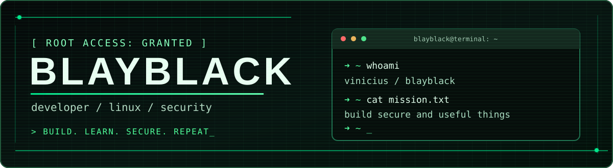
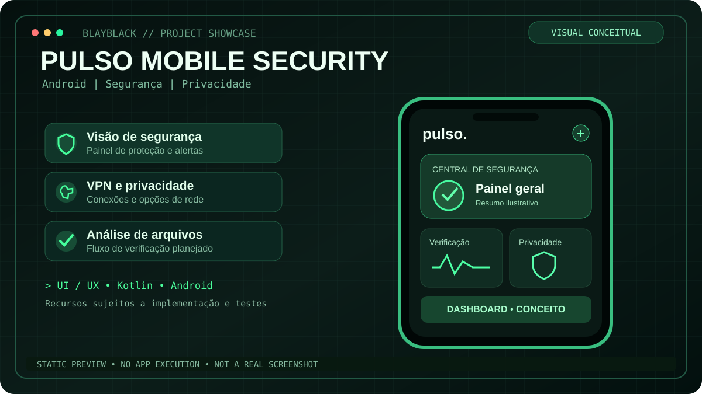
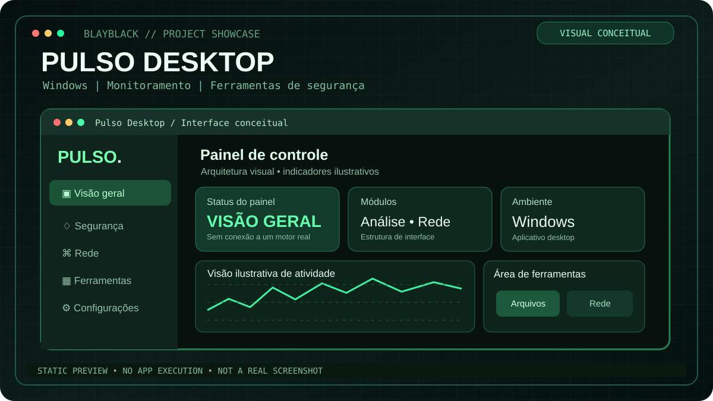
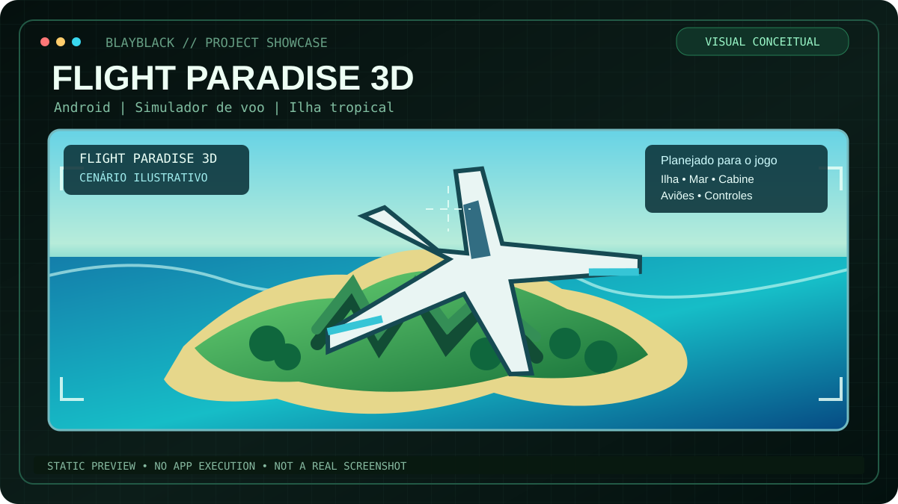
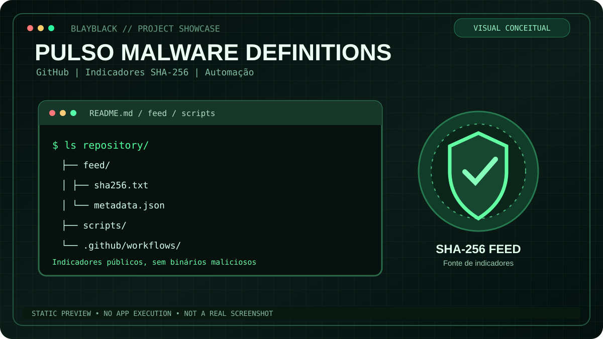

<div align="center">
  
  <br />
  
  <br />
  
  
</div>

---

## `> whoami`

```bash
$ whoami
blayblack@terminal

$ cat about.txt
> Estudante de Análise e Desenvolvimento de Sistemas
> Experiência com suporte técnico e infraestrutura de TI
> Interesse em Linux, automação, desenvolvimento e cibersegurança

$ echo $MISSION
"Aprender, construir e criar ferramentas úteis com segurança."
```

## `> ls /skills`

<div align="center">

**Linguagens e desenvolvimento**


**Sistemas, infraestrutura e ferramentas**


</div>

## `> ls /projects --showcase`

<div align="center">

**PORTFÓLIO VISUAL // BLAYBLACK**

<sub>Imagens estáticas criadas para apresentar o conceito dos projetos. Não são capturas de versões funcionais nem demonstrações executáveis.</sub>

</div>

<table>
<tr>
<td width="50%" valign="top">
  
  <h3>🛡️ Pulso Mobile Security</h3>
  <p><strong>Android · Em desenvolvimento</strong></p>
  <p>Suíte de segurança e privacidade para Android. O projeto reúne ideias e módulos de <strong>verificação de arquivos</strong>, <strong>VPN</strong>, <strong>proteção contra spam</strong>, gerenciamento de senhas e uma central de segurança visual.</p>
  <p><sub>Prévia de interface ilustrativa. A imagem não comprova o funcionamento desses recursos.</sub></p>
</td>
<td width="50%" valign="top">
  
  <h3>🖥️ Pulso Desktop</h3>
  <p><strong>Windows · Em desenvolvimento</strong></p>
  <p>Projeto de uma aplicação desktop com foco em <strong>monitoramento</strong>, <strong>segurança</strong>, <strong>ferramentas de rede</strong> e organização de funções em um dashboard moderno.</p>
  <p><sub>Prévia conceitual do design, sem simular um antivírus em execução.</sub></p>
</td>
</tr>
<tr>
<td width="50%" valign="top">
  
  <h3>✈️ Flight Paradise 3D</h3>
  <p><strong>Android · Em desenvolvimento</strong></p>
  <p>Projeto de simulador de voo 3D ambientado em uma <strong>ilha tropical</strong>, com oceano, seleção de aviões, visão de cabine e controles imersivos. <strong>Multiplayer via rede local</strong> é uma funcionalidade planejada.</p>
  <p><sub>Arte representativa do cenário planejado, não uma captura de gameplay real.</sub></p>
</td>
<td width="50%" valign="top">
  
  <h3>🧬 Pulso Malware Definitions</h3>
  <p><strong>GitHub · Repositório público</strong></p>
  <p>Repositório de <strong>indicadores SHA-256</strong> e scripts para o ecossistema Pulso. Contém uma estrutura de feed de hashes e workflow para atualizações programadas, dependentes de configuração e de serviços externos.</p>
  <p><sub>Ilustração da estrutura. Um feed de hashes isolado não equivale a proteção antivírus completa.</sub></p>
  <p><a href="https://github.com/Blayblack/pulso-malware-definitions">Consultar documentação do repositório</a></p>
</td>
</tr>
</table>

<div align="center">
<sub><strong>SHOWCASE ONLY</strong> — Sem APK, instalador, botões para executar ou demonstrações funcionais nesta página. O código de repositórios públicos existentes permanece independente deste perfil.</sub>
</div>

## `> cat /currently-learning`

- 🔐 Segurança da informação, análise de ameaças e boas práticas defensivas
- 🐧 Linux, servidores, redes e automação
- 📱 Desenvolvimento Android e aplicações multiplataforma
- 🎓 Análise e Desenvolvimento de Sistemas

## `> ./connect.sh`

<div align="center">

[](https://github.com/Blayblack)
[](https://github.com/Blayblack?tab=repositories)

<sub><code>root@blayblack:~# keep_learning --every-day</code></sub>

<sub>⚠️ Projetos marcados como “em desenvolvimento” não representam produtos finalizados ou proteções validadas.</sub>

</div>
